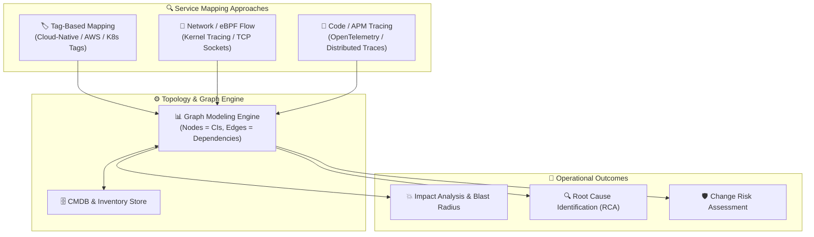

  

  
  
  
  
  
  
  

---

# 🗺️ Awesome Service Mapping

> **A curated collection of SaaS platforms, enterprise tools, and open-source solutions for Application Dependency Mapping (ADM), CMDB Topology Discovery, Microservices Tracing, and Service Impact Analysis.**

**Service Mapping** automatically identifies, maps, and visualizes the complex relationships between user-facing business applications and the underlying IT infrastructure—including microservices, cloud resources, virtual machines, databases, message brokers, and physical networks. These solutions empower DevOps, SRE, and ITOM teams to perform **rapid root-cause analysis (RCA)**, assess **blast radius for change management**, eliminate blind spots during cloud migrations, and ensure continuous high availability.

---

## 📑 Table of Contents

- [🌐 Sector Overview & Market Dynamics](#-sector-overview--market-dynamics)
- [💼 SaaS & Enterprise Service Mapping Platforms](#-saas--enterprise-service-mapping-platforms)
- [🔓 Open-Source GitHub Projects](#-open-source-github-projects)
- [🧠 Key Architectural Patterns](#-key-architectural-patterns)
- [🤝 How to Contribute](#-how-to-contribute)
- [⭐ Star History](#-star-history)
- [💖 Support & Community](#-support--community)
- [⚖️ Disclaimer](#-disclaimer)

---

## 🌐 Sector Overview & Market Dynamics

The global **Service Mapping and Application Discovery & Dependency Mapping (ADDM)** software sector is estimated at **$2.73B to $4.08B (2024–2026)** and is projected to expand to **$7.08B to $9.62B by 2034–2035**, sustaining a **11.2% to 21.4% CAGR** driven by cloud modernization, container proliferation, and strict digital operational resilience regulations (such as DORA).

The industry is **moderately concentrated at the enterprise top-tier**—with legacy ITSM giants (ServiceNow, BMC) and observability leaders (Cisco/AppDynamics, Datadog, Dynatrace) capturing the lion's share of Fortune 500 enterprise CMDB budgets—yet remains **fragmented across specialized niches**, where eBPF-powered zero-code tracers, CNCF developer portals, and sovereign self-hosted open-source graph engines prevent a single winner-take-all monopoly.

---

## 💼 SaaS & Enterprise Service Mapping Platforms

The table below outlines category-leading commercial platforms sorted descending by company size (market capitalization, enterprise valuation, or annual revenue).

| Platform / Vendor | Company Size (Market Cap / Revenue) | Starting Pricing (Specific Tier) | Free Tier / Trial Limits | Key Capabilities & Architecture Focus |
| :--- | :--- | :--- | :--- | :--- |
| **[AppDynamics](https://www.appdynamics.com/)** (Cisco) | **~$225B Market Cap** / $53.8B Rev *(Acquired for $3.7B)* | **$6 / vCPU / mo** (Infrastructure); **$33 / mo / host** (Premium APM with Service Map, billed annually) | **15-day free trial** with full APM and Service Map features (up to 5 agents/hosts) | Real-time service topology flow maps, distributed transaction correlation, and automated cross-tier dependency discovery. |
| **[ServiceNow Service Mapping](https://www.servicenow.com/)** | **~$190B Market Cap** / $10.0B Rev | **~$10,000 – $15,000 / yr** base *(ITOM Visibility at ~$0.50 – $1.50 / node / mo or ~$150 – $200 / fulfiller agent / mo)* | **Perpetual Free Personal Developer Instance (PDI)** on developer.servicenow.com with full ITOM suite; **30-day enterprise PoC** upon request | Top-down, tag-based, and ML-assisted dependency discovery deeply synchronized with ServiceNow CMDB and Event Management. |
| **[Datadog Service Map](https://www.datadoghq.com/)** | **~$42B Market Cap** / $2.6B Rev | **$31 / host / mo** (annual commitment) or **$36 / host / mo** (on-demand) under APM Core | **14-day free trial** with unlimited hosts and full Service Map capabilities; **Free-forever tier** covers up to 5 hosts (infrastructure metrics only) | Interactive service decomposition map illustrating callers/callees, error cascades, and live latency metrics across microservices. |
| **[Dynatrace](https://www.dynatrace.com/)** | **~$16B Market Cap** / $1.43B Rev | **$0.01 per memory-GiB-hour** (~$58 / mo for an 8 GiB host) on Dynatrace Platform Subscription (DPS) | **15-day free trial** with full-stack observability, Smartscape topology engine, and OneAgent automated injection (no credit card required) | Patented Smartscape technology mapping vertical and horizontal dependencies from bare metal to cloud applications in real time. |
| **[BMC Helix Discovery](https://www.bmc.com/)** | **~$8.5B Valuation** (KKR) / $2.3B Rev | **£15.75 / unit / mo** on UK G-Cloud marketplace *(Enterprise list benchmark: ~$80 – $140 / node / mo)* | **30-day guided Proof of Concept (PoC)** sandbox environment featuring multi-cloud discovery and service modeling | Dynamic blueprint modeling, agentless multi-cloud asset mapping, and automated sync with BMC Helix AIOps and CMDB. |
| **[New Relic Service Map](https://newrelic.com/)** | **~$6.5B Valuation** (TPG / Francisco) / $930M Rev | **$0.40 / GB** beyond 100 GB allowance; Standard plan is **$10** for 1st user + **$99 / mo** per additional Full Platform user | **Free forever tier** with 100 GB/mo data ingest, 1 Full Platform user, unlimited basic users, and full Service Architecture Intelligence | Dynamic upstream/downstream connection mapping with configurable relationship depth (1–3 hops) and distributed tracing overlays. |
| **[Device42](https://www.device42.com/)** (Freshworks) | **~$4.2B Market Cap** / $600M+ Rev *(Acquired for $230M)* | **$1,449 / yr** base Core tier (licenses up to 100 devices and 1,000 IP addresses); ADM available as modular add-on | **14-day free trial** virtual appliance deployment discovering up to 100 devices and application dependencies | Agentless discovery and Application Dependency Mapping (ADM) across hybrid IT estates, physical racks, containers, and hypervisors. |
| **[SolarWinds SAM](https://www.solarwinds.com/)** | **~$2.1B Market Cap** / $760M Rev | **$2,900** perpetual/subscription starting tier (SAM AL150 for up to 150 component monitors) | **30-day fully functional free trial** with unlimited component monitors, AppStack, and TCP connection discovery | Automatic polling of TCP socket and process-level connections, packet loss diagnostics, and cross-tier AppStack correlation. |
| **[ScienceLogic SL1](https://sciencelogic.com/)** (Skylar One) | **~$1.0B Valuation** / ~$150M Rev | **$5 / device / mo** (Base Base Monitoring); **$6 – $20 / device / mo** (Advanced ML & AIOps Automation tiers) | **14-day test drive / free trial** evaluation environment for Skylar One and SL1 platform | Layer 2 and Layer 3 discovery, cloud-edge dependency inference, geographic topology mapping, and automated incident triage. |
| **[Virima](https://virima.com/)** | **~$75M Valuation** / ~$20M Rev | **$395 / mo** ($4,740 / yr billed annually) for Business Pro tier (includes up to 2,000 assets, unlimited users) | **14-day guided Proof of Value (PoV)** sandbox with automated discovery and Services Topology View | Visual Services Topology View, asset relationship discovery, ESXi virtual mapping, and ITIL change impact analysis. |

---

## 🔓 Open-Source GitHub Projects

Curated open-source software for building sovereign CMDBs, internal developer catalogs, and automated dependency graph visualizers—**sorted descending by GitHub star count**.

1. **[Backstage](https://github.com/backstage/backstage)**   
   *CNCF Graduated Developer Portal by Spotify (TypeScript / React / Node.js)*  
   An extensible open-source developer portal with a centralized **Software Catalog** that manages system models, APIs, and microservices. Dependency visualization plugins and relationship graphs allow teams to explore upstream and downstream component links.

2. **[Apache SkyWalking](https://github.com/apache/skywalking)**   
   *APM & Observability Analysis Platform (Java / Go / Rust / C++)*  
   Designed specifically for microservices, cloud-native systems, and distributed architectures. SkyWalking automatically reconstructs interactive service topology maps and endpoint graphs from distributed telemetry without manual configuration.

3. **[Jaeger](https://github.com/jaegertracing/jaeger)**   
   *CNCF Distributed Tracing Platform (Go)*  
   Monitors complex microservice transactions and automatically builds directed acyclic graph (DAG) dependency diagrams showing service-to-service call patterns, latency bottlenecks, and error propagation paths.

4. **[NetBox](https://github.com/netbox-community/netbox)**   
   *Infrastructure Resource Modeling, IPAM & DCIM (Python / Django)*  
   The premier open-source source of truth for modern networks. NetBox models physical cables, racks, devices, VLANs, VRFs, and virtual machines, providing the underlying hardware topology necessary for complete service mapping.

5. **[Coroot](https://github.com/coroot/coroot)**   
   *Zero-Instrumentation eBPF Observability Engine (Go)*  
   Leverages Linux eBPF to automatically discover services, network connections, and databases with zero code changes. Live interactive service maps display throughput, TCP retransmissions, latency, and root-cause advisories.

6. **[GLPI](https://github.com/glpi-project/glpi)**   
   *Open-Source ITSM & Asset Management Suite (PHP)*  
   An enterprise ITIL service management solution with comprehensive asset discovery, CMDB relationships, and native GraphViz integration to render graphical impact analysis diagrams for CI outages.

7. **[Zabbix](https://github.com/zabbix/zabbix)**   
   *Enterprise Monitoring Platform (C / PHP / Go)*  
   Includes a native **Service Monitoring (IT Services)** engine that constructs tree-like parent-child service hierarchies. Problem propagation rules, tag-based mapping, and SLA calculators provide business-level impact visibility from underlying hardware alarms.

8. **[Weave Scope](https://github.com/weaveworks/scope)**   
   *Container & Process Dependency Visualizer (Go / JavaScript)*  
   Automatically maps processes, containers, and Kubernetes pods in real time. Generates interactive visual topologies showing networking links, resource usage, and active traffic flows without requiring pre-configured maps.

9. **[DeepFlow](https://github.com/deepflowio/deepflow)**   
   *eBPF-Powered Universal Observability Platform (Rust / Golang)*  
   Achieves zero-code auto-tracing and universal service topology across hybrid clouds, Kubernetes clusters, and legacy bare-metal hosts, generating complete service dependency graphs down to the network and kernel layers.

10. **[Kiali](https://github.com/kiali/kiali)**   
    *Service Mesh Observability Console for Istio (Go / React)*  
    Provides instantaneous visual topology for microservices within an Istio service mesh. Features live traffic animations, request rate indicators, circuit-breaker flags, and mutual TLS (mTLS) status overlays.

11. **[Skydive](https://github.com/skydive-project/skydive)**   
    *Real-Time Network Topology & Protocol Analyzer (Go)*  
    Captures network topology across SDN controllers, Linux namespaces, Open vSwitch, and Docker bridges, visually graph-modeling how service packets travel across virtual and physical network topologies.

12. **[iTop](https://github.com/Combodo/iTop)**   
    *ITIL-Aligned ITSM & CMDB Hub (PHP)*  
    Fully customizable open-source CMDB organizing servers, virtual machines, applications, and business services. Employs GraphViz to deliver visual impact analyses indicating which business clients and services suffer during a CI failure.

13. **[NetBox Services Plugin](https://github.com/renatoalmeidaoliveira/nbservice)**   
    *Service Entity Extension for NetBox (Python)*  
    Adds a formal Service model to NetBox (supporting L2VPN, L3VPN, DIA, Voice, and CDN), binding high-level business services to low-level interfaces, IP prefixes, ASNs, and virtual circuits.

14. **[Imbi](https://github.com/AWeber-Imbi/imbi)**   
    *DevOps Service Management & Catalog Platform (Python)*  
    An API-first service tracking platform built on PostgreSQL with the Apache AGE graph extension, designed to model service dependencies, ownership boundaries, and operational health scoring.

15. **[Atlas CMDB](https://github.com/mojoaar/atlascmdb)**   
    *Modern Open-Source CMDB (TypeScript / Next.js / React)*  
    Lightweight, self-hosted CMDB with Dagre auto-layout and breadth-first search (BFS) multi-hop dependency graphing (1–6 hops) for exploring relationships between business services, hosts, and cloud assets.

---

## 🧠 Key Architectural Patterns

Modern Service Mapping implementations typically fall into three primary discovery patterns:

* **Tag-Based Discovery:** Leverages cloud resource tags (`Environment`, `Application`, `Tier`) to instantly group assets into business services.
* **Network & eBPF Telemetry:** Monitors socket connections and Linux kernel packets non-invasively to identify upstream callers and downstream dependencies.
* **Distributed APM Traces:** Ingests OpenTelemetry or vendor-agent spans to produce exact code-level dependency maps across microservice APIs and databases.

---

## 🤝 How to Contribute

Contributions to this ecosystem are warmly welcomed! To suggest a new tool or update an existing entry:

1. **Fork the repository** on GitHub.
2. **Add or modify entries** in [`README.md`](file:///C:/Users/hp/Documents/Projects/Awesome-Service-Mapping/README.md) following the established tabular format (SaaS) or star-sorted list (Open-Source).
3. **Ensure strict data accuracy**:
   - Provide concrete starting prices and exact free trial / free tier limits.
   - For open-source tools, include the standard shields.io star badge linking to `/stargazers`.
4. **Submit a Pull Request** with a brief summary of your additions.

---

##  Star History

---

## 💖 Support & Community

Thank you for exploring **Awesome Service Mapping**! If this curated guide helps you architect more resilient systems, optimize your CMDB, or troubleshoot faster:

- ⭐ **Star this repository** to help other engineers discover it.
- 🍴 **Fork it** to maintain your team's internal inventory.
- 📢 **Share it** with SREs, enterprise architects, and DevOps peers on LinkedIn, X/Twitter, or Reddit.
- ☕ **Support the author**: If you'd like to buy a coffee or sponsor ongoing maintenance, please visit the [GitHub Sponsor Dashboard](https://github.com/sponsors/ishandutta2007).

---

## ⚖️ Disclaimer

* This repository is community-curated for informational and architectural evaluation purposes only; inclusion does not constitute an endorsement.
* Pricing figures, free tier limits, and corporate valuations reflect public market indicators as of late 2024–2026 and are subject to vendor updates.
* Always review open-source licenses (MIT, AGPL-3.0, Apache-2.0) before deploying within proprietary production environments.
